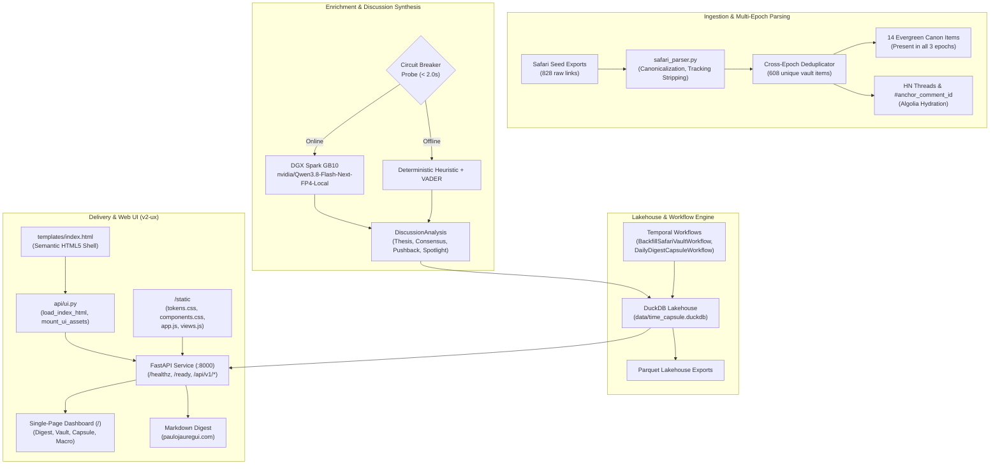

# Digital Time Capsule & Daily Tech Discussion Digest (`time-capsule`)

Autonomous longitudinal technical reading vault lakehouse, DGX Spark technical discussion synthesis, and daily publication digest engine for `paulojauregui.com`.

---

## 1. Architectural Overview

`time-capsule` ingests, canonicalizes, deduplicates, and analyzes multi-epoch technical reading lists and online discussion threads across 3 distinct historical epochs:
- **`2023_2024` Genesis Epoch**: 229 raw links capturing initial exploration into LLM internals, distributed systems, software career craft, and vocabulary lexicon lookups.
- **`2026_08_16` Summer Bridge Epoch**: 279 raw links capturing Kubernetes bare-metal orchestration, Linux kernel development, local LLM harnesses, and GPU compute topologies.
- **`2026_11_06` Production Epoch**: 320 raw links reflecting autonomous agent infrastructure, DGX Spark vLLM inference, Temporal durable execution, and self-hosted homelab mechanics.



---

## 2. Six Intellectual Pillars Taxonomy

All reading vault links, search intents, and synthesized discussions are categorized into 6 core intellectual pillars:

| Pillar Key | Name | Core Subject Matter |
| :--- | :--- | :--- |
| `PILLAR_1_AI_LLM_AGENTS` | AI, LLMs & Autonomous Agents | Transformers, LLM inference engines (vLLM), prompt routing, agent loops, reasoning models. |
| `PILLAR_2_SYSTEMS_KERNEL` | Systems, Kernel & Low-Level | Linux kernel internals, memory allocators, page cache, eBPF, Rust, C, NVMe queue depths. |
| `PILLAR_3_INFRA_K8S_HOMELAB` | Infrastructure, Kubernetes & Homelab | K3s bare-metal clusters, Cilium CNI, SeaweedFS, GitOps (ArgoCD), KubeVirt VMs, NixOS gateways. |
| `PILLAR_4_MATH_ML_THEORY` | Mathematics, ML & Foundations | Linear algebra, numerical optimization, graph theory, distributed consensus math, loss mechanics. |
| `PILLAR_5_SWE_CRAFT_CAREER` | Software Craftsmanship & Career | Architecture paradigms, refactoring, systems design, senior engineer career progression, testing. |
| `PILLAR_6_HUMANITIES_LIFE` | Humanities, Life & Culture | Philosophy, psychology, cognitive science, historical perspectives, calm technology. |

---

## 3. The 14 Evergreen Canon Items

Reading list items that survived across all three historical epochs (`2023_2024`, `2026_08_16`, `2026_11_06`):

1. **Calm Technology** (`https://calmtech.com`) - `PILLAR_3_INFRA_K8S_HOMELAB`
2. **Lessons Learned from Twenty Years of Site Reliability Engineering | Hacker News** (`https://news.ycombinator.com/item?id=38037141`) - `PILLAR_3_INFRA_K8S_HOMELAB`
3. **How to Not Get Screwed over as a Software Engineer \[video\] | Hacker News** (`https://news.ycombinator.com/item?id=38112827`) - `PILLAR_5_SWE_CRAFT_CAREER`
4. **This Is Your Brain on Books - Public Books** (`https://publicbooks.org/this-is-your-brain-on-books`) - `PILLAR_6_HUMANITIES_LIFE`
5. **Ask HN: What side projects landed you a job? | Hacker News** (`https://news.ycombinator.com/item?id=38511280`) - `PILLAR_5_SWE_CRAFT_CAREER`
6. **You are never taught how to build quality software | Hacker News** (`https://news.ycombinator.com/item?id=38570261`) - `PILLAR_5_SWE_CRAFT_CAREER`
7. **The art of high performance computing | Hacker News** (`https://news.ycombinator.com/item?id=38815334`) - `PILLAR_2_SYSTEMS_KERNEL`
8. **The 8 Stages of Life That Make or Break You - Darius Foroux** (`https://dariusforoux.com/stages-of-life`) - `PILLAR_6_HUMANITIES_LIFE`
9. **Why are we templating YAML? (2019) | Hacker News** (`https://news.ycombinator.com/item?id=39101828`) - `PILLAR_3_INFRA_K8S_HOMELAB`
10. **Data Structures for Data-Intensive Applications (cs-people.bu.edu)** (`https://cs-people.bu.edu/mathan/publications/fnt23-athanassoulis.pdf`) - `PILLAR_2_SYSTEMS_KERNEL`
11. **How do neural networks learn? | Hacker News** (`https://news.ycombinator.com/item?id=39744669`) - `PILLAR_4_MATH_ML_THEORY`
12. **Building reliable systems out of unreliable agents | Hacker News** (`https://news.ycombinator.com/item?id=39984209`) - `PILLAR_1_AI_LLM_AGENTS`
13. **Show HN: I built a game to help you learn neural network architectures | Hacker News** (`https://news.ycombinator.com/item?id=40429200`) - `PILLAR_4_MATH_ML_THEORY`
14. **First we shape our social graph, then it shapes us (2022) | Hacker News** (`https://news.ycombinator.com/item?id=40769006`) - `PILLAR_6_HUMANITIES_LIFE`

---

## 4. API Endpoints

| Method | Path | Description |
| :--- | :--- | :--- |
| `GET` | `/healthz` | Kubernetes liveness probe returning service operational status. |
| `GET` | `/ready` | Kubernetes readiness probe verifying DuckDB connectivity and seed item count. |
| `GET` | `/` | Interactive single-page dashboard featuring 4 views: Daily Tech Digest, 3-Epoch Reading Vault, Personal Time Capsule, and Macro Time Machine. |
| `GET` | `/api/v1/vault` | Multi-parameter filtered query over vault items (`epoch`, `is_evergreen_canon`, `pillar`, `source_type`, `min_sentiment`, `search`, `limit`). |
| `GET` | `/api/v1/epochs/summary` | Longitudinal summary across the 3 epochs, evergreen canon, anchored items, and taste profile. |
| `POST` | `/api/v1/vault/import` | Ingest raw Safari Reading List lines or markdown text and merge into the lakehouse. |
| `POST` | `/api/v1/vault/{item_id}/analyze` | Trigger on-demand discussion synthesis via DGX Spark vLLM (with deterministic offline fallback). |
| `GET` | `/api/v1/intents` | Categorized search query intents (`technical_learning`, `vocabulary`, `personal_life`). |
| `GET` | `/api/v1/vocabulary` | Personal technical vocabulary lexicon terms and definitions. |
| `GET` | `/api/v1/digests` | Historical list of generated `DailyCapsuleSnapshot` summaries. |
| `GET` | `/api/v1/capsule/{capsule_date}` | Retrieve or dynamically synthesize daily capsule snapshot and publication Markdown digest. |

---

## 5. Modular `v2-ux` Frontend Architecture

The dashboard is a dependency-free, zero-build single-page application. `api/ui.py` resolves the asset directories beside the installed package, renders the shell via `load_index_html()`, and mounts `/static` through `mount_ui_assets()`, so templates and static assets are served from the same wheel that ships the Python code.

| Asset | Responsibility |
| :--- | :--- |
| `src/time_capsule/api/templates/index.html` | Semantic HTML5 shell: skip link, `role="banner"` header, status pills, `role="tablist"` navigation, 4 `role="tabpanel"` workspaces, dialogs, and the `aria-live="polite"` status region. No `<style>` tags, inline `style` attributes, or inline JS. |
| `src/time_capsule/api/static/tokens.css` | Design token contract (Archival Observatory): the only stylesheet permitted raw hex/rgba literals. Everything downstream consumes `var(--*)`. |
| `src/time_capsule/api/static/components.css` | Layout primitives and component classes: tab bar, cards, wells, badges, skeleton keyframes, numeric columns. |
| `src/time_capsule/api/static/app.js` | Application controller: `appState` store, tab switching, WAI-ARIA roving tabindex, global keyboard shortcuts, modal focus management, `aria-live` announcements, and REST data loaders. |
| `src/time_capsule/api/static/views.js` | `window.TimeCapsuleViews`: pure, XSS-safe string renderers for the 5 deterministic component states across all workspaces and modals. |
| `src/time_capsule/api/ui.py` | Typed asset loader and static mount helper (`get_templates_dir`, `get_static_dir`, `load_index_html`, `mount_ui_assets`). |

### 5.1 WCAG 2.2 AA Keyboard Navigation

All functionality is reachable without a pointer; focus is never trapped or lost.

| Key | Context | Behavior |
| :--- | :--- | :--- |
| `ArrowLeft` / `ArrowRight` | Tab bar | Moves the roving tabindex between the 4 workspace tabs, wrapping at both ends, and activates the newly focused tab. |
| `Home` / `End` | Tab bar | Jumps focus to the first / last tab. |
| `/` or `Cmd/Ctrl+K` | Anywhere outside a text field | Switches to the Vault workspace and focuses (and selects) the vault search input. |
| `Escape` | Open modal | Dismisses `#import-modal` or `#analysis-modal` and restores focus to the stored `lastFocusedElement` trigger. |
| `Escape` | Vault search field | Clears the active search filter and reloads the unfiltered vault. |
| `Tab` | Shell | Skip link (`Skip to main workspace`) precedes all interactive content; each `tabpanel` is focusable. |

A screen-reader-only `aria-live="polite"` region announces tab switches, filter changes, import results, and analysis completion without stealing focus.

### 5.2 Five-State Rendering Determinism

Every data-driven region renders through one of 5 deterministic states; no region is ever left in an undefined visual condition:

| State | Trigger | Rendering Contract |
| :--- | :--- | :--- |
| `Empty` | Successful query, zero rows | Neutral empty well with guidance copy, `aria-busy="false"`. |
| `Loading` | Request in flight | Fixed-height skeleton placeholders (`skeleton-card`, `skeleton-row`, `skeleton-line`, `skeleton-well`) with `aria-busy="true"`. Reserved height keeps cumulative layout shift at `CLS = 0`; pulsing is suppressed under `prefers-reduced-motion`. |
| `Nominal` | Populated response | Fully rendered cards, tables, and wells; scores use `tabular-nums` for column alignment. |
| `Degraded/Offline` | `model_used == "heuristic-vader"` | Header model pill switches to `pill-degraded` and the `#degraded-mode-banner` announces deterministic VADER + anchor sub-thread fallback instead of DGX Spark vLLM synthesis. |
| `Error` | Transport or HTTP failure | `role="alert"` error well with the failing reason and a retry button that re-invokes the originating loader. |

### 5.3 Archival Observatory Design Tokens

- **Numeric alignment**: `.tabular-nums` and `.num-col` apply `font-variant-numeric: tabular-nums` so sentiment, controversy, counts, and anchor IDs align in columns instead of jittering between renders.
- **Evergreen Canon amber reservation**: `--canon-amber-text`, `--canon-amber-bg`, and `--canon-amber-border` are reserved exclusively for the 14 Evergreen Canon items and anchor spotlights, preserving amber as an unambiguous "survived all 3 epochs" signal. Source-platform and status badges use their own token families instead.
- **Elevation & contrast**: 4-tier dark surface hierarchy (`--bg-canvas`, `--bg-surface-1`, `--bg-surface-2`, `--bg-elevated`) with a text ramp verified at >= 4.5:1 (AA) and >= 10:1 (AAA), plus a dedicated `--focus-ring` token.
- **Motion**: `--duration-fast` / `--ease-out` bound animation to purposeful state feedback only, with all decoration gated behind `prefers-reduced-motion`.
- **No emojis**: Emoji characters are prohibited across templates, stylesheets, JavaScript, and their tests.

---

## 6. Local Development & Verification

### Install Dependencies

```bash
poetry install --with dev
```

### Run Verification Suite

```bash
# Run 145 fast deterministic tests
poetry run pytest -v

# Run Ruff linter
poetry run ruff check .

# Run MyPy static type analysis
poetry run mypy src tests

# Verify wheel and sdist ship the dashboard templates and static assets
poetry build
python -c "import zipfile,glob; print('\n'.join(n for n in zipfile.ZipFile(sorted(glob.glob('dist/*.whl'))[-1]).namelist() if 'static/' in n or 'templates/' in n))"

# Verify GitOps Kustomize build
kubectl kustomize deploy/base
```

### Run Web Application Locally

```bash
poetry run python -m time_capsule.api.main
```

Open `http://localhost:8000` in your browser.

---

## 7. GitOps Deployment

The service is packaged as a non-root container image (`USER 10001:10001`) and deployed to Kubernetes via Kustomize:

- **Deployment**: `deploy/base/01-deployment.yaml` with liveness (`/healthz`) and readiness (`/ready`) probes.
- **Service**: `deploy/base/02-service.yaml` exposing port `80` targeting container port `8000`.
- **HTTPRoute**: `deploy/base/03-httproute.yaml` attached to Gateway API `homelab-gateway` in namespace `argocd`, routing `time-capsule.paulojauregui.com`.
