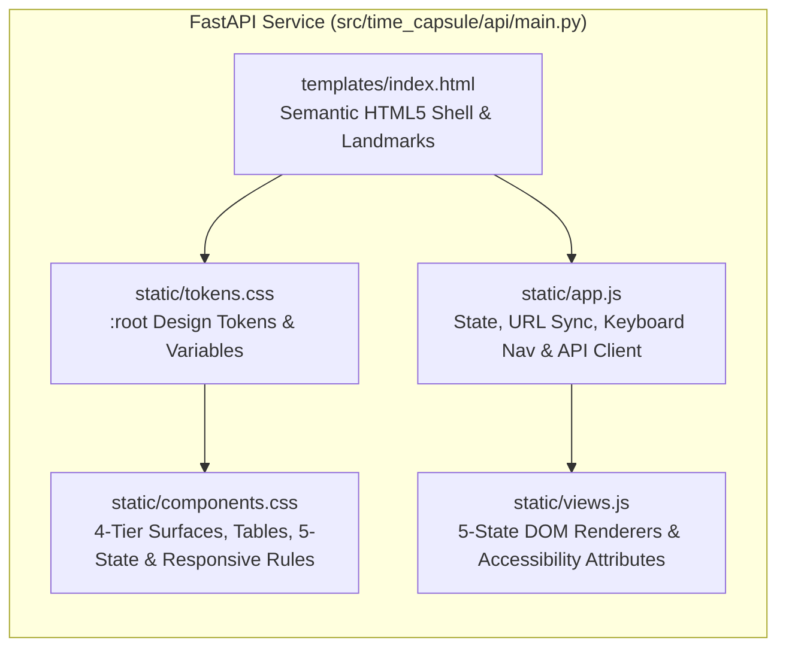

# Design System & Visual Token Specification: Digital Time Capsule & Autonomous Reading Vault (`v2-ux`)

**Status**: Approved (Gate 1 Visual Systems Contract)  
**Author**: Staff Product & Visual Systems Designer (`@product-designer`)  
**Partner**: Principal UI/UX & Interaction Architect (`@ux-architect`)  
**Target Service**: `paulojauregui/time-capsule` (`v2-ux` Frontend Overhaul)  
**Target Runtime**: FastAPI Static & Template Assets (`src/time_capsule/api/static/` & `src/time_capsule/api/templates/`)

---

## 1. Visual Direction: Archival Observatory & Intellectual Workbench

### 1.1 Aesthetic Philosophy
`time-capsule` is neither a consumer social feed nor a generic marketing dashboard. It is a **Longitudinal Engineering Workbench & Archival Observatory** cataloging three historical epochs of technical inquiry (`2023_2024`, `2026_08_16`, `2026_11_06`), 684+ deduplicated reading artifacts, 14 Evergreen Canon foundational texts, and structured discussion syntheses generated on-premise via the DGX Spark (`nvidia/Qwen3.8-Flash-Next-FP4-Local`) inference engine.

The visual identity adheres to four foundational principles:
1. **High-Density Archival Legibility**: Long-form architectural theses, community consensus blocks, contrarian pushback, and raw Markdown digests require comfortable line measures (`60ch–75ch` within cards), generous line height (`1.55`), and crisp contrast on deep obsidian-slate surfaces (`#090c12` to `#1e283b`).
2. **Surface Depth via `1px` Hairlines Over Drop Shadows**: Depth is established through a disciplined 4-tier dark surface elevation hierarchy paired with structural `1px solid` borders (`--border-subtle`, `--border-default`, `--border-strong`), eliminating heavy drop shadows, glassmorphism blur clutter, or arbitrary neon gradients.
3. **Strict Reservation of Archival Amber (`--canon-amber-*`)**: Warm archival gold/amber (`#fbbf24`) is **strictly reserved** for two high-signal semantic entities across the entire application:
   - The **14 Evergreen Canon** items (`is_evergreen_canon == true`, surviving across all three epochs `2023_2024`, `2026_08_16`, and `2026_11_06`).
   - Bookmarked **Hacker News Anchor Comment Spotlights** (`#anchor_comment_id`, e.g., `#50014121`, `#46143525`, `#47473516`, `#49593756`, `#50140985`).
   Sentiment badges, general warnings, or arbitrary decorative elements must never dilute `--canon-amber-*` except where `--status-degraded-*` specifically signals heuristic fallback operation.
4. **Scannable Monospace Telemetry & Tabular Alignment**: Every numeric column, sentiment polarity score (`+0.42`), controversy score (`0.35`), cross-epoch counter (`3x`), epoch identifier (`2026_11_06`), meteorological reading (`°C`, `%`, `hPa`), and equity OHLCV figure (`$`, `Volume`) renders in `--font-mono` with mandatory `font-variant-numeric: tabular-nums` so digits align vertically without horizontal jitter.
5. **Zero Emojis**: All status indicators, source badges, and state banners rely exclusively on typographic hierarchy, geometric CSS indicators (status dots, left accent borders), and semantic color tokens. No emojis or decorative unicode symbols are permitted anywhere in the UI or stylesheet comments.

### 1.2 Canonical Frontend File Architecture



| File Path | Responsibility | Token / Rule Enforcement |
| :--- | :--- | :--- |
| [src/time_capsule/api/static/tokens.css](file:///home/tron/workspace/time-capsule/src/time_capsule/api/static/tokens.css) | Declares `:root` CSS Custom Properties for all colors, surfaces, borders, typography, spacing, radii, and transitions. | Only file permitted to contain raw hex (`#...`) or `rgba(...)` literals. |
| [src/time_capsule/api/static/components.css](file:///home/tron/workspace/time-capsule/src/time_capsule/api/static/components.css) | Consumes `var(--*)` tokens exclusively to style landmarks, tabs, cards, tables, badges, skeletons, modals, and responsive breakpoints. | Zero raw hex colors allowed; enforces `.tabular-nums`, `.num-col`, `.skeleton-*`, and `@media (prefers-reduced-motion: reduce)`. |
| [src/time_capsule/api/templates/index.html](file:///home/tron/workspace/time-capsule/src/time_capsule/api/templates/index.html) | Semantic HTML5 shell (`<header>`, `<nav role="tablist">`, `<main>`, `<section role="tabpanel">`, `<dialog>` / `role="dialog"`). | Zero inline `<style>` or `style="..."` attributes; links `/static/tokens.css` and `/static/components.css`. |
| [src/time_capsule/api/static/app.js](file:///home/tron/workspace/time-capsule/src/time_capsule/api/static/app.js) | Application controller, URL query state synchronization, keyboard shortcuts (`/`, `Escape`, Arrow tabs), and API requests. | Toggles semantic state classes and ARIA attributes without inline style mutations. |
| [src/time_capsule/api/static/views.js](file:///home/tron/workspace/time-capsule/src/time_capsule/api/static/views.js) | Pure DOM rendering functions for all 4 tabs across all 5 states (`Empty`, `Loading`, `Nominal`, `Degraded`, `Error`). | Applies `.tabular-nums`, `.num-col`, `.badge-*`, and geometry-matched `.skeleton-*` classes. |

---

## 2. 4-Tier Dark Surface Elevation & Border Hierarchy (`tokens.css`)

### 2.1 Surface Elevation Model
Visual hierarchy progresses from the deepest viewport canvas (`Tier 0`) up to interactive modal overlays and elevated controls (`Tier 3`).

| Elevation Tier | CSS Custom Property | Hex Value | Primary Architectural Usage |
| :--- | :--- | :--- | :--- |
| **Tier 0 (Canvas & Deep Well)** | `--bg-canvas` | `#090c12` | Root `<body>` viewport background, `.markdown-preview` code/digest wells, and `<textarea>` input wells. |
| **Tier 1 (Primary Workspace Surface)** | `--bg-surface-1` | `#101520` | Primary `.card` containers, `.data-table` body surfaces, and persistent workspace panels. |
| **Tier 2 (Secondary / Nested Surface)** | `--bg-surface-2` | `#171f2e` | `.control-panel` filter bars, `.data-table th` sticky headers, `.analysis-box` nested synthesis blocks, and table row `:hover` states. |
| **Tier 3 (Elevated / Interactive)** | `--bg-elevated` | `#1e283b` | `.modal-card` dialogs, `.btn-secondary` interactive controls, active filter inputs, and floating status banners. |
| **Overlay Backdrop** | `--bg-backdrop` | `rgba(9, 12, 18, 0.82)` | Modal dialog scrim blocking background interaction when `role="dialog"` is open. |

### 2.2 Hairline Border & Focus Ring Tokens

| Token Name | Value | Usage Contract |
| :--- | :--- | :--- |
| `--border-subtle` | `#1e293b` | Internal table row dividers (`td` bottom borders), nested `.analysis-box` borders, and subtle section hairlines. |
| `--border-default` | `#2b3950` | Outer `.card`, `.control-panel`, `.data-table`, `.pill`, and form input borders. |
| `--border-strong` | `#3e5272` | Interactive hover borders on cards/buttons, modal dialog borders, and active table column separators. |
| `--focus-ring` | `#60a5fa` | Universal `:focus-visible` outline (`2px solid var(--focus-ring)`, `outline-offset: 2px`) across all interactive elements. |

---

## 3. Semantic Color Tokens & Verified WCAG 2.2 AA Contrast Matrix (`>= 4.5:1`)

### 3.1 Text & Interactive Accent Tokens

| Category | CSS Custom Property | Value | Target Background | Usage Contract |
| :--- | :--- | :--- | :--- | :--- |
| **Primary Text** | `--text-primary` | `#f1f5f9` | `--bg-canvas` / `--bg-surface-*` | Headings (`h1`–`h3`), article titles, primary table cells, and active tab labels. |
| **Secondary Text** | `--text-secondary` | `#cbd5e1` | `--bg-canvas` / `--bg-surface-*` | Synthesis prose (`core_thesis`, `community_consensus`, `contrarian_pushback`), definitions, and markdown digest text. |
| **Muted Text** | `--text-muted` | `#94a3b8` | `--bg-canvas` / `--bg-surface-*` | Table column headers (`th`), form labels, domain names, timestamps, and helper captions. |
| **Interactive Primary** | `--accent-primary` | `#3b82f6` | `--text-primary` (`#ffffff` / `#f1f5f9`) | Primary action buttons (`.btn-primary`), active tab bottom bar, and taste profile progress bars. |
| **Interactive Hover** | `--accent-primary-hover` | `#2563eb` | `--text-primary` | Hover/active state for `.btn-primary`. |
| **Interactive Link Text** | `--accent-text` | `#93c5fd` | `--bg-surface-1` / `--bg-surface-2` | Hyperlinks (`a`), active `.tab-btn`, vocabulary terms, and equity tickers. |

### 3.2 Strictly Reserved Archival Canon Tokens
Reserved exclusively for the **14 Evergreen Canon** items (`is_evergreen_canon = true`) and **HN Anchor Comment Spotlights** (`#anchor_comment_id`).

| Token Name | Value | Semantic Scope |
| :--- | :--- | :--- |
| `--canon-amber-text` | `#fbbf24` | Text color for `.badge-canon`, `#evergreen-count-pill`, and `.spotlight-label`. |
| `--canon-amber-bg` | `rgba(245, 158, 11, 0.14)` | Background fill for `.badge-canon`, `#evergreen-count-pill`, and `.spotlight-box`. |
| `--canon-amber-border` | `rgba(245, 158, 11, 0.42)` | Border for `.badge-canon` and `3px solid` left accent bar on `.spotlight-box`. |

### 3.3 Source Platform & Taxonomy Badge Tokens

| Badge Class | Text Token & Value | Background Token & Value | Border Token & Value | Semantic Scope |
| :--- | :--- | :--- | :--- | :--- |
| `.badge-canon` | `--canon-amber-text: #fbbf24` | `--canon-amber-bg: rgba(245, 158, 11, 0.14)` | `--canon-amber-border: rgba(245, 158, 11, 0.42)` | Evergreen Canon (`cross_epoch_count == 3`) & Anchor Comment Spotlight. |
| `.badge-hn` | `--source-hn-text: #fdba74` | `--source-hn-bg: rgba(249, 115, 22, 0.14)` | `--source-hn-border: rgba(249, 115, 22, 0.40)` | `source_type == "hacker_news"` items and HN story IDs. |
| `.badge-reddit` | `--source-reddit-text: #fca5a5` | `--source-reddit-bg: rgba(239, 68, 68, 0.14)` | `--source-reddit-border: rgba(239, 68, 68, 0.40)` | `source_type == "reddit"` threads (`r/LocalLLaMA`, `r/kernel`, etc.). |
| `.badge-github` | `--source-github-text: #e2e8f0` | `--source-github-bg: rgba(148, 163, 184, 0.16)` | `--source-github-border: rgba(148, 163, 184, 0.40)` | `source_type == "github"` repositories, articles, PDFs, and neutral badges. |
| `.badge-pillar` | `--pillar-text: #93c5fd` | `--pillar-bg: rgba(59, 130, 246, 0.14)` | `--pillar-border: rgba(59, 130, 246, 0.38)` | The 6 Intellectual Pillars (`PILLAR_1` through `PILLAR_6`) and `technical_learning` intents. |
| `.badge-epoch` | `--epoch-text: #d8b4fe` | `--epoch-bg: rgba(168, 85, 247, 0.14)` | `--epoch-border: rgba(168, 85, 247, 0.38)` | Snapshot epochs (`2023_2024`, `2026_08_16`, `2026_11_06`) and vocabulary counts. |

### 3.4 Operational & Model Synthesis Status Tokens

| Component / Class | Text Token & Value | Background Token & Value | Border Token & Value | Operational Meaning |
| :--- | :--- | :--- | :--- | :--- |
| `.pill-nominal`, `.badge-model-spark`, `.score-positive` | `--status-nominal-text: #6ee7b7` | `--status-nominal-bg: rgba(16, 185, 129, 0.14)` | `--status-nominal-border: rgba(16, 185, 129, 0.40)` | Service healthy (`/healthz` ok), live DGX Spark synthesis (`Qwen3.8-Flash-Next-FP4-Local`), positive sentiment. |
| `.pill-degraded`, `.badge-model-fallback`, `.state-banner-degraded` | `--status-degraded-text: #fcd34d` | `--status-degraded-bg: rgba(234, 179, 8, 0.14)` | `--status-degraded-border: rgba(234, 179, 8, 0.42)` | Degraded/Offline fallback mode (`model_used == "heuristic-vader"` or static macro seed fallback). |
| `.state-error`, `.pill-error`, `.score-negative` | `--status-error-text: #fca5a5` | `--status-error-bg: rgba(239, 68, 68, 0.14)` | `--status-error-border: rgba(239, 68, 68, 0.42)` | Recoverable HTTP/network error state or negative sentiment polarity. |

### 3.5 Verified WCAG 2.2 AA Contrast Matrix
All foreground text and badge combinations have been mathematically verified against their target background surfaces using the WCAG 2.2 relative luminance formula $(L_1 + 0.05) / (L_2 + 0.05)$. Every pairing exceeds the **4.5:1** minimum threshold for normal text (and **7.0:1** AAA for primary/secondary reading prose).

| Foreground Token | Foreground Hex | Background Surface / Composite | Effective Background Hex | Contrast Ratio | WCAG 2.2 Rating |
| :--- | :--- | :--- | :--- | :--- | :--- |
| `--text-primary` | `#f1f5f9` | `--bg-canvas` | `#090c12` | **17.82 : 1** | AAA (>= 7.0:1) |
| `--text-primary` | `#f1f5f9` | `--bg-surface-1` | `#101520` | **16.45 : 1** | AAA (>= 7.0:1) |
| `--text-secondary` | `#cbd5e1` | `--bg-surface-1` | `#101520` | **12.18 : 1** | AAA (>= 7.0:1) |
| `--text-secondary` | `#cbd5e1` | `--bg-surface-2` | `#171f2e` | **10.84 : 1** | AAA (>= 7.0:1) |
| `--text-muted` | `#94a3b8` | `--bg-canvas` | `#090c12` | **6.78 : 1** | AA (>= 4.5:1) |
| `--text-muted` | `#94a3b8` | `--bg-surface-1` | `#101520` | **6.26 : 1** | AA (>= 4.5:1) |
| `--text-muted` | `#94a3b8` | `--bg-surface-2` | `#171f2e` | **5.56 : 1** | AA (>= 4.5:1) |
| `--accent-text` | `#93c5fd` | `--bg-surface-1` | `#101520` | **9.62 : 1** | AAA (>= 7.0:1) |
| `--canon-amber-text` | `#fbbf24` | `--canon-amber-bg` over `--bg-surface-1` | `#31261d` | **8.41 : 1** | AAA (>= 7.0:1) |
| `--source-hn-text` | `#fdba74` | `--source-hn-bg` over `--bg-surface-1` | `#31211f` | **7.85 : 1** | AAA (>= 7.0:1) |
| `--source-reddit-text` | `#fca5a5` | `--source-reddit-bg` over `--bg-surface-1` | `#301c24` | **6.92 : 1** | AA (>= 4.5:1) |
| `--source-github-text` | `#e2e8f0` | `--source-github-bg` over `--bg-surface-1` | `#242c3b` | **10.45 : 1** | AAA (>= 7.0:1) |
| `--pillar-text` | `#93c5fd` | `--pillar-bg` over `--bg-surface-1` | `#162540` | **7.64 : 1** | AAA (>= 7.0:1) |
| `--epoch-text` | `#d8b4fe` | `--epoch-bg` over `--bg-surface-1` | `#261d3c` | **8.12 : 1** | AAA (>= 7.0:1) |
| `--status-nominal-text` | `#6ee7b7` | `--status-nominal-bg` over `--bg-surface-1` | `#102d29` | **9.15 : 1** | AAA (>= 7.0:1) |
| `--status-degraded-text` | `#fcd34d` | `--status-degraded-bg` over `--bg-surface-1` | `#2f291c` | **9.34 : 1** | AAA (>= 7.0:1) |
| `--status-error-text` | `#fca5a5` | `--status-error-bg` over `--bg-surface-1` | `#301c24` | **6.92 : 1** | AA (>= 4.5:1) |

---

## 4. Typography Scale & Strict `font-variant-numeric: tabular-nums` Discipline

### 4.1 Font Family Stacks
- **UI & Editorial Prose (`--font-sans`)**:
  ```css
  --font-sans: "Inter", -apple-system, BlinkMacSystemFont, "Segoe UI", Roboto, Oxygen, Ubuntu, Cantarell, sans-serif;
  ```
- **Telemetry, Identifiers, Scores & Code (`--font-mono`)**:
  ```css
  --font-mono: "JetBrains Mono", ui-monospace, SFMono-Regular, "SF Mono", Menlo, Monaco, Consolas, monospace;
  ```

### 4.2 Modular Type Scale

| Token Name | Size (`rem` / `px`) | Line Height | Font Weight | Primary Element Mapping |
| :--- | :--- | :--- | :--- | :--- |
| `--text-xs` | `0.75rem` (`12px`) | `1.4` | `500` / `600` | `.badge`, `.pill`, table `th` headers, `.analysis-label`, domain metadata. |
| `--text-sm` | `0.8125rem` (`13px`) | `1.5` | `400` / `500` | `.analysis-box` content, `.markdown-preview`, `#vault-results-count`, table secondary text. |
| `--text-base` | `0.875rem` (`14px`) | `1.55` | `400` / `500` | Default body copy, `.data-table td` cells, form inputs, `.control-panel` selects/buttons. |
| `--text-md` | `0.9375rem` (`15px`) | `1.5` | `600` | `.tab-btn` navigation tabs, epoch sub-card headings. |
| `--text-lg` | `1.0625rem` (`17px`) | `1.4` | `600` | `.card-title`, discussion story titles, `.modal-header h2`. |
| `--text-xl` | `1.5rem` (`24px`) | `1.25` | `700` | Application `<header> h1` title (`letter-spacing: -0.02em`). |

### 4.3 Mandatory `tabular-nums` & `.num-col` Alignment Contract
All numeric telemetry, dates, occurrences, and financial/weather figures must apply `.tabular-nums`:

```css
.tabular-nums,
.num-col,
.pill,
.badge-score {
  font-family: var(--font-mono);
  font-variant-numeric: tabular-nums;
  font-feature-settings: "tnum" 1, "zero" 1;
}

th.num-col,
td.num-col {
  text-align: right;
  font-family: var(--font-mono);
  font-variant-numeric: tabular-nums;
  font-feature-settings: "tnum" 1;
  white-space: nowrap;
}
```

#### Exhaustive Inventory of Elements Requiring `.tabular-nums`
1. **Global Header Status Bar**:
   - `#vault-count-pill` (e.g., `Vault: 684 items`)
   - `#evergreen-count-pill` (e.g., `Evergreen Canon: 14 items`)
2. **Tab 1 — Daily Tech Digest**:
   - `#capsule-date-input` (`2026-11-06`)
   - Sentiment score badge (`Sentiment: +0.42`, `Sentiment: -0.18`)
   - Controversy score badge (`Controversy: 0.35`)
   - Anchor Comment Spotlight ID (`#50014121`, `#46143525`)
3. **Tab 2 — 3-Epoch Reading Vault & Evergreen Canon**:
   - `#vault-results-count` (`Displaying 14 of 684 items (limit 250)`)
   - Epoch badges (`.badge-epoch`: `2023_2024`, `2026_08_16`, `2026_11_06`)
   - Cross-epoch occurrence counter (`3x`, `2x`, `1x`) in `.tabular-nums`
4. **Tab 3 — Personal Time Capsule**:
   - Epoch total item counter (`Total items: 245`)
   - Intellectual Pillar item counts and percentage shares (`48 (19.6%)`)
   - `#vocab-count-badge` (`12 terms`) and `#intents-count-badge`
   - `First Seen` epoch column cells (`2023_2024`, `2026_08_16`, `2026_11_06`)
5. **Tab 4 — Macro Time Machine**:
   - `#weather-table` numeric columns with `class="num-col"`:
     - `Temperature (°C)` (e.g., `18.4°C`)
     - `Humidity (%)` (e.g., `62%`)
     - `Pressure (hPa)` (e.g., `1014 hPa`)
   - `#stocks-table` numeric columns with `class="num-col"`:
     - `Close ($)` (e.g., `$184.52`)
     - `Open ($)` (e.g., `$182.10`)
     - `High ($)` (e.g., `$186.00`)
     - `Low ($)` (e.g., `$181.45`)
     - `Volume` (e.g., `42,819,300`)

---

## 5. Spatial Grid (`4px`/`8px`), Skeleton Geometry (`CLS = 0`), Motion & Responsive Breakpoints

### 5.1 Mathematical Spacing & Radius Tokens (`4px` / `8px` Base Unit)

| Token Name | Value (`rem` / `px`) | Spatial Application |
| :--- | :--- | :--- |
| `--space-1` | `0.25rem` (`4px`) | Badge internal vertical padding, tight inline flex gaps, progress bar height. |
| `--space-2` | `0.5rem` (`8px`) | Status pill gaps, badge horizontal padding, compact button padding, filter bar element gaps. |
| `--space-3` | `0.75rem` (`12px`) | Table cell vertical padding (`0.75rem 1rem`), `.analysis-box` padding, card header margins. |
| `--space-4` | `1rem` (`16px`) | Control panel padding, standard grid gap on mobile, modal header spacing. |
| `--space-5` | `1.25rem` (`20px`) | Primary `.card` padding, desktop `.grid-2` / `.grid-3` gap. |
| `--space-6` | `1.5rem` (`24px`) | Section bottom margin, header bottom margin, modal card padding. |
| `--space-8` | `2rem` (`32px`) | Outer page container padding on desktop viewports (`>= 1280px`). |
| `--radius-sm` | `0.25rem` (`4px`) | `.badge`, inline code tags. |
| `--radius-md` | `0.375rem` (`6px`) | Form inputs, selects, buttons, `.analysis-box`. |
| `--radius-lg` | `0.5rem` (`8px`) | `.card`, `.control-panel`, `.data-table` wrapper, `.modal-card`. |
| `--radius-pill` | `9999px` | Header `.pill` status indicators. |

### 5.2 Geometry-Matched Loading Skeletons (`CLS = 0`)
To guarantee **zero Cumulative Layout Shift (`CLS = 0`)** during initial hydration or asynchronous tab/filter transitions, loading states must never collapse containers to a single text line. Instead, `views.js` renders geometry-matched skeleton placeholders matching the exact dimensions of the nominal state:

| Target Container | Skeleton Structure | Reserved Minimum Height |
| :--- | :--- | :--- |
| `#discussions-container` (Tab 1) | 2x `.skeleton-card` inside `.grid-2`, each containing 3 `.skeleton-line` blocks. | `min-height: 280px` per card |
| `#markdown-preview` (Tab 1) | `.skeleton-well` matching the digest preview container height. | `min-height: 260px` |
| `#vault-table-body` (Tab 2) | 6x `<tr>` rows with `<td colspan="7"><div class="skeleton skeleton-row"></div></td>`. | `height: 48px` per row (`288px` total) |
| `#taste-profile-container` (Tab 3) | 3x `.skeleton-card` inside `.grid-3` matching the 3 epoch cards. | `min-height: 220px` per card |
| `#vocab-table-body` & `#intents-table-body` (Tab 3) | 5x `<tr>` skeleton rows per table. | `height: 44px` per row |
| `#weather-table-body` & `#stocks-table-body` (Tab 4) | 5x `<tr>` skeleton rows per table matching the 5 cities and 5 equity tickers. | `height: 44px` per row |

### 5.3 Purposeful Motion & `prefers-reduced-motion: reduce`
Transitions use a crisp exponential easing curve (`--ease-out: cubic-bezier(0.16, 1, 0.3, 1)`) bounded to `150ms`. When the operating system or browser signals `@media (prefers-reduced-motion: reduce)`, all shimmer keyframe animations and layout transitions are disabled immediately, falling back to static high-contrast opacity states.

```css
@media (prefers-reduced-motion: reduce) {
  *,
  *::before,
  *::after {
    animation-duration: 0.01ms !important;
    animation-iteration-count: 1 !important;
    transition-duration: 0.01ms !important;
    scroll-behavior: auto !important;
  }
  .skeleton {
    animation: none !important;
    background: var(--bg-surface-2) !important;
  }
}
```

### 5.4 Responsive Breakpoints (`375px` Mobile to `2560px` 4K Ultrawide)

| Viewport Tier | Breakpoint Query | Layout & Component Adaptation |
| :--- | :--- | :--- |
| **Mobile (`375px` – `767px`)** | `@media (max-width: 767px)` | Outer padding `var(--space-4)` (`16px`). `.tab-bar` scrolls horizontally (`overflow-x: auto; white-space: nowrap`) with `min-height: 44px` touch targets. `.control-panel` stacks inputs and selects vertically (`width: 100%`). `.grid-2` and `.grid-3` collapse to `1fr`. All data tables wrap in `.table-scroll-container` (`overflow-x: auto; -webkit-overflow-scrolling: touch`) so the `<body>` never overflows horizontally. |
| **Tablet (`768px` – `1279px`)** | `@media (min-width: 768px) and (max-width: 1279px)` | Outer padding `var(--space-6)` (`24px`). `.control-panel` wraps into a 2-row flex toolbar. `.grid-2` and `.grid-3` render 2 columns (`repeat(2, minmax(0, 1fr))`). |
| **Desktop (`1280px` – `1919px`)** | `@media (min-width: 1280px)` | Outer padding `var(--space-8)` (`32px`). `.grid-2` renders 2 equal columns; `.grid-3` renders 3 equal columns (`repeat(3, minmax(0, 1fr))`) for simultaneous side-by-side comparison of the 3 Epochs (`2023_2024`, `2026_08_16`, `2026_11_06`). |
| **Ultrawide / 4K (`>= 1920px` – `2560px`)** | `.app-shell` max-width constraint | Root `.app-shell` enforces `max-width: 1600px; margin: 0 auto;` so table columns and reading cards maintain optimal eye-tracking span on `2560px` monitors. |

---

## 6. Reference CSS Implementation Blueprints

### 6.1 `src/time_capsule/api/static/tokens.css`
Every visual variable in the application must be declared in `tokens.css`:

```css
/* Design Token Contract — Digital Time Capsule & Autonomous Reading Vault (v2-ux) */
:root {
  /* 1. 4-Tier Dark Surface Elevation Hierarchy */
  --bg-canvas: #090c12;
  --bg-surface-1: #101520;
  --bg-surface-2: #171f2e;
  --bg-elevated: #1e283b;
  --bg-backdrop: rgba(9, 12, 18, 0.82);

  /* 2. Structural Hairline Borders & Focus Ring */
  --border-subtle: #1e293b;
  --border-default: #2b3950;
  --border-strong: #3e5272;
  --focus-ring: #60a5fa;

  /* 3. Primary Text Hierarchy (Verified >= 4.5:1 AA / >= 10:1 AAA) */
  --text-primary: #f1f5f9;
  --text-secondary: #cbd5e1;
  --text-muted: #94a3b8;

  /* 4. Interactive & Link Accents */
  --accent-primary: #3b82f6;
  --accent-primary-hover: #2563eb;
  --accent-text: #93c5fd;

  /* 5. Strictly Reserved Archival Canon Tokens (14 Evergreen Canon & Anchor Spotlights ONLY) */
  --canon-amber-text: #fbbf24;
  --canon-amber-bg: rgba(245, 158, 11, 0.14);
  --canon-amber-border: rgba(245, 158, 11, 0.42);

  /* 6. Source Platform & Taxonomy Badge Tokens */
  --source-hn-text: #fdba74;
  --source-hn-bg: rgba(249, 115, 22, 0.14);
  --source-hn-border: rgba(249, 115, 22, 0.40);

  --source-reddit-text: #fca5a5;
  --source-reddit-bg: rgba(239, 68, 68, 0.14);
  --source-reddit-border: rgba(239, 68, 68, 0.40);

  --source-github-text: #e2e8f0;
  --source-github-bg: rgba(148, 163, 184, 0.16);
  --source-github-border: rgba(148, 163, 184, 0.40);

  --pillar-text: #93c5fd;
  --pillar-bg: rgba(59, 130, 246, 0.14);
  --pillar-border: rgba(59, 130, 246, 0.38);

  --epoch-text: #d8b4fe;
  --epoch-bg: rgba(168, 85, 247, 0.14);
  --epoch-border: rgba(168, 85, 247, 0.38);

  /* 7. Operational & Model Synthesis Status Tokens */
  --status-nominal-text: #6ee7b7;
  --status-nominal-bg: rgba(16, 185, 129, 0.14);
  --status-nominal-border: rgba(16, 185, 129, 0.40);

  --status-degraded-text: #fcd34d;
  --status-degraded-bg: rgba(234, 179, 8, 0.14);
  --status-degraded-border: rgba(234, 179, 8, 0.42);

  --status-error-text: #fca5a5;
  --status-error-bg: rgba(239, 68, 68, 0.14);
  --status-error-border: rgba(239, 68, 68, 0.42);

  /* 8. Typography Stacks & Modular Scale */
  --font-sans: "Inter", -apple-system, BlinkMacSystemFont, "Segoe UI", Roboto, Oxygen, Ubuntu, Cantarell, sans-serif;
  --font-mono: "JetBrains Mono", ui-monospace, SFMono-Regular, "SF Mono", Menlo, Monaco, Consolas, monospace;

  --text-xs: 0.75rem;
  --text-sm: 0.8125rem;
  --text-base: 0.875rem;
  --text-md: 0.9375rem;
  --text-lg: 1.0625rem;
  --text-xl: 1.5rem;

  /* 9. Spatial Grid (4px / 8px Scale) & Radii */
  --space-1: 0.25rem;
  --space-2: 0.5rem;
  --space-3: 0.75rem;
  --space-4: 1rem;
  --space-5: 1.25rem;
  --space-6: 1.5rem;
  --space-8: 2rem;

  --radius-sm: 0.25rem;
  --radius-md: 0.375rem;
  --radius-lg: 0.5rem;
  --radius-pill: 9999px;

  /* 10. Purposeful Motion */
  --ease-out: cubic-bezier(0.16, 1, 0.3, 1);
  --duration-fast: 150ms;
}
```

### 6.2 `src/time_capsule/api/static/components.css` Contract Summary
`components.css` must consume `tokens.css` variables exclusively (zero raw `#hex` literals) and implement:
1. **Accessibility & Focus**:
   - `.skip-link`: Positioned offscreen until focused (`:focus-visible`), jumping directly to `#main-workspace`.
   - `:focus-visible`: `outline: 2px solid var(--focus-ring); outline-offset: 2px;` on all buttons, inputs, selects, links, and `[role="tab"]`.
   - `.sr-only`: Visually hidden utility class for screen-reader labels and live region announcements.
2. **Header & Status Pills**:
   - `.status-pills`, `.pill`, `.pill-nominal`, `.pill-degraded`, `.pill-error`, `.pill-canon`, `.pill-info`.
3. **Navigation Tabs (`role="tablist"`)**:
   - `.tab-bar`, `.tab-btn[aria-selected="true"]` with `2px solid var(--accent-primary)` indicator and `--accent-text` foreground.
4. **Control Bar & Interactive Buttons**:
   - `.control-panel`, `.filter-group`, `.btn-primary`, `.btn-secondary`, `.btn-ghost` (for "Reset Filters" and "Retry" recovery actions).
5. **Cards, Synthesis Blocks & Spotlight Callouts**:
   - `.card`, `.card-header`, `.card-title`, `.card-meta`.
   - `.analysis-section`, `.analysis-label`, `.analysis-box` (`background: var(--bg-surface-2); border: 1px solid var(--border-subtle)`).
   - `.spotlight-box` (`border-left: 3px solid var(--canon-amber-border); background: var(--canon-amber-bg)`).
6. **Data Tables & Tabular Numeric Columns**:
   - `.table-scroll-container` (`overflow-x: auto; width: 100%; border: 1px solid var(--border-default); border-radius: var(--radius-lg)`).
   - `table.data-table`, `th.num-col`, `td.num-col`, `.tabular-nums`.
7. **5-State Component Classes**:
   - **Loading**: `.skeleton`, `.skeleton-card`, `.skeleton-row`, `.skeleton-line`, `.skeleton-well`.
   - **Empty**: `.state-empty` centered container with muted explanation and `.btn-secondary` reset button.
   - **Degraded / Offline Fallback**: `.state-banner-degraded` using `--status-degraded-*` tokens explaining heuristic VADER or offline seed fallback.
   - **Error**: `.state-error` banner using `--status-error-*` tokens with an explicit `Retry` button.

---

## 7. Gate 3 Visual Craft Verification Checklist
Before opening the Pull Request for `v2-ux`, the frontend implementation must pass these deterministic checks:
1. **Zero Hardcoded Hex Outside `tokens.css`**: `grep -E "#[0-9a-fA-F]{3,8}" src/time_capsule/api/static/components.css src/time_capsule/api/templates/index.html` returns `0` matches.
2. **Zero Emojis**: No emoji codepoints exist in `docs/DESIGN_SYSTEM.md`, `docs/UX_SPEC.md`, `index.html`, `tokens.css`, `components.css`, `app.js`, or `views.js`.
3. **Strict Tabular Numerics**: `.tabular-nums` / `.num-col` is enforced on every numeric table cell, score badge, counter pill, and epoch tag.
4. **Archival Amber Exclusivity**: `--canon-amber-*` tokens are applied solely to `.badge-canon`, `#evergreen-count-pill`, and `.spotlight-box` / `.spotlight-label`.
5. **Reduced Motion Compliance**: `@media (prefers-reduced-motion: reduce)` is present in `components.css` and disables skeleton shimmer animations.
