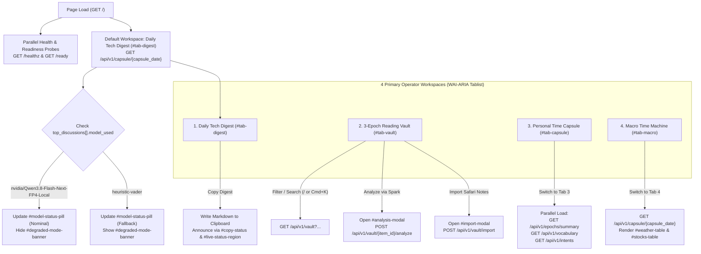
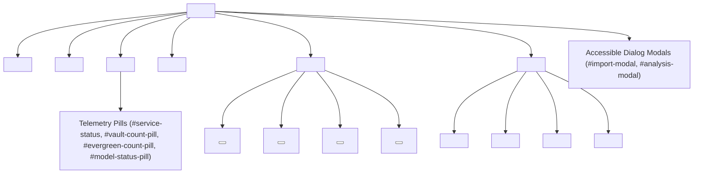
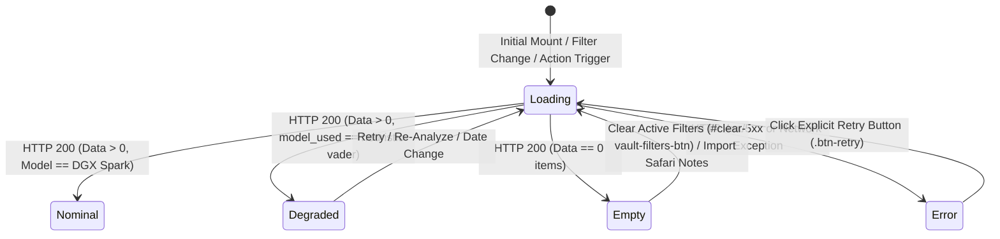

# UI/UX & Interaction Architecture Specification (`docs/UX_SPEC.md`)

**Service**: `time-capsule` (Digital Time Capsule & Autonomous Reading Vault)  
**Iteration**: `v2-ux` (Gate 1 UI/UX Architecture & Accessibility Specification)  
**Author**: Principal UI/UX & Interaction Architect (`@ux-architect`)  
**Target Platform**: `mainframe` K3s Homelab (`time-capsule.paulojauregui.com`) + Local DGX Spark (`happy.tail749110.ts.net:8000`)  
**Compliance Standard**: WCAG 2.2 Level AA, WAI-ARIA 1.2 Design Patterns, 5-State Deterministic UI Architecture  

---

## 1. Executive Purpose & Canonical Frontend File Architecture

The `v2-ux` overhaul of `time-capsule` decouples the inline prototype dashboard from `src/time_capsule/api/main.py` into a modular, accessible, zero-build static frontend asset architecture served by FastAPI. The interface is engineered for high-density technical telemetry, zero cumulative layout shift (`CLS = 0`), complete keyboard operability, and explicit visibility into whether discussion synthesis is powered by on-premise DGX Spark (`nvidia/Qwen3.8-Flash-Next-FP4-Local`) or the deterministic `heuristic-vader` fallback.

### 1.1 Canonical Frontend Module Topology

| File Path | Architectural Role & Responsibility |
| :--- | :--- |
| `src/time_capsule/api/templates/index.html` | Semantic HTML5 document structure, skip links, ARIA live status region, banner header, WAI-ARIA `tablist` navigation, four `tabpanel` sections, and accessible modal `<div role="dialog">` containers. |
| `src/time_capsule/api/static/tokens.css` | Design system CSS custom properties: 4-tier surface hierarchy (`--bg-canvas`, `--bg-surface`, `--bg-elevated`, `--bg-overlay`), typography (`--font-sans`, `--font-mono`), `4px`/`8px` spacing scale, focus ring tokens (`--focus-ring`), and semantic status badges. |
| `src/time_capsule/api/static/components.css` | Component rules for layout grid, sticky header, tab bar, filter control bar, data tables (`font-variant-numeric: tabular-nums`), discussion cards, skeleton loaders (`.skeleton`, `.skeleton-card`, `.skeleton-row`, `.skeleton-line`), state banners (`.state-empty`, `.state-banner-degraded`, `.state-error`), modals, and responsive breakpoints (`320px` to `2560px`). |
| `src/time_capsule/api/static/views.js` | Pure, deterministic DOM rendering functions for all five component states (`Empty`, `Loading`, `Nominal`, `Degraded/Offline`, `Error`), HTML-escaping helpers, and model badge formatters (`.badge-model-spark` vs `.badge-model-fallback`). |
| `src/time_capsule/api/static/app.js` | Application state controller, REST API client bindings, WAI-ARIA roving `tabindex` tab controller, keyboard shortcut listener (`/`, `Cmd+K`/`Ctrl+K`, `Escape`), accessible modal focus manager, and `aria-live="polite"` status announcer. |
| `src/time_capsule/api/ui.py` | FastAPI static asset mount helper (`/static`) and HTML template loader serving `GET /` with `src/time_capsule/api/templates/index.html`. |

### 1.2 Backend API Contract Preservation Matrix

All frontend interactions bind strictly to the existing FastAPI endpoints in `src/time_capsule/api/main.py` and Pydantic models in `src/time_capsule/models.py`:

| HTTP Method & Route | Request Contract | Response Payload Contract | Consuming UI Workspace / Component |
| :--- | :--- | :--- | :--- |
| `GET /` | None | `text/html; charset=utf-8` (`index.html`) | Root Single-Page Application Shell |
| `GET /healthz` | None | `{"status": "ok", "service": "time-capsule"}` | Header `#service-status` telemetry pill |
| `GET /ready` | None | `{"status": "ready", "vault_count": int, "evergreen_count": int}` | Header `#vault-count-pill` and `#evergreen-count-pill` |
| `GET /api/v1/capsule/{capsule_date}` | Path `capsule_date` (`YYYY-MM-DD`) | `DailyCapsuleSnapshot` (`capsule_date`, `weather_records`, `stock_records`, `top_discussions`, `evergreen_spotlight`, `markdown_digest`) | `#tab-digest` (`#discussions-container`, `#markdown-preview`) & `#tab-macro` (`#weather-table`, `#stocks-table`) |
| `GET /api/v1/vault` | Query `epoch`, `is_evergreen_canon`, `pillar`, `source_type`, `min_sentiment`, `search`, `limit=250` | `{"count": int, "items": list[SafariLinkItem]}` | `#tab-vault` (`#vault-results-count`, `#vault-table-body`) |
| `POST /api/v1/vault/import` | JSON `VaultImportRequest` (`{"text": str, "epoch_id": str}`) | `{"imported_raw_count": int, "total_vault_items": int, "evergreen_count": int}` | `#import-modal` (`#import-form`, `#submit-import-btn`) |
| `POST /api/v1/vault/{item_id}/analyze` | Path `item_id`; JSON `AnalyzeRequest` (`{"allow_llm": true, "allow_external_hydration": false}`) | `DiscussionAnalysis` (`item_id`, `title`, `core_thesis`, `community_consensus`, `contrarian_pushback`, `anchor_comment_spotlight`, `sentiment_score`, `controversy_score`, `actionable_takeaways`, `model_used`) | `#analysis-modal` (`#analysis-modal-body`) & `#model-status-pill` / `#degraded-mode-banner` |
| `GET /api/v1/epochs/summary` | None | `{"evergreen_canon": list[SafariLinkItem], "total_unique_items": int, "epoch_breakdown": dict[str, int], "taste_profile": dict}` | `#tab-capsule` (`#taste-profile-container`) |
| `GET /api/v1/vocabulary` | Optional query `epoch` | `{"count": int, "vocabulary": list[VocabularyEntry]}` | `#tab-capsule` (`#vocab-count-badge`, `#vocab-table-body`) |
| `GET /api/v1/intents` | Optional query `category`, `epoch` | `{"count": int, "intents": list[SearchQueryIntent]}` | `#tab-capsule` (`#intent-category-select`, `#intents-table-body`) |
| `GET /api/v1/digests` | None | `{"digests": list[DailyCapsuleSnapshot], "top_analyses": list[DiscussionAnalysis]}` | Digest history inspection / API consumers |

---

## 2. Operator Persona & Core User Journeys

### 2.1 Primary Operator Persona

* **Persona**: Senior AI Infrastructure & Systems Engineer (`Paulo Jauregui / @HowDiggy`)
* **Operational Environment**: Multi-monitor desktop workstation (`1440p`/`4K`), laptop (`1280px`--`1440px`), and mobile reading client (`375px`--`430px`) accessing `time-capsule` over local network or Tailscale.
* **Core Objectives**:
  1. Curate a longitudinal 3-epoch reading vault (`2023_2024` Genesis Epoch, `2026_08_16` Summer Bridge Epoch, `2026_11_06` Production Epoch) containing 828 raw Safari bookmarks/tabs deduplicated into canonical items and 14 Evergreen Canon works (`cross_epoch_count == 3`).
  2. Synthesize dense Hacker News, Reddit, and systems engineering threads using local DGX Spark (`nvidia/Qwen3.8-Flash-Next-FP4-Local`) with immediate visibility into sentiment polarity, controversy index, community consensus, contrarian pushback, and `#anchor_comment_id` spotlights.
  3. Publish daily curated Markdown digests to `paulojauregui.com` with one-click clipboard export.
  4. Track longitudinal intellectual shift across the 6 Intellectual Pillars, personal vocabulary lexicon entries, and categorized technical learning queries.

### 2.2 End-to-End User Journeys Across the 4 Workspaces



#### Journey 1: Daily Tech Digest (`#tab-digest`)
1. **Entry & Date Selection**: Upon loading `GET /`, `#tab-digest` is the active workspace (`aria-selected="true"` on `#tab-btn-digest`). The operator views or edits the target date (`YYYY-MM-DD`) in `#capsule-date-input` (labeled by `<label for="capsule-date-input">Capsule Date</label>`) and triggers `#load-capsule-btn`.
2. **Capsule Synthesis**: While `GET /api/v1/capsule/{capsule_date}` is in flight, `#discussions-container` and `#markdown-preview` enter `aria-busy="true"` and render geometry-matched skeleton placeholders (`.skeleton-card`, `.skeleton-line`).
3. **Executive Discussion Highlights**: When the response arrives, `#discussions-container` renders high-density discussion analysis cards. Each card displays:
   - Item title and metadata badges: Sentiment score (`+0.XX` / `-0.XX` with `tabular-nums`), Controversy score (`0.XX`), and inference model badge (`.badge-model-spark` for `nvidia/Qwen3.8-Flash-Next-FP4-Local` or `.badge-model-fallback` for `heuristic-vader`).
   - Structured synthesis blocks: `Core Thesis`, `Community Consensus`, `Contrarian Pushback`, conditional `Anchor Comment Spotlight (#anchor_comment_id)` in a left-accented `.spotlight-box`, and `Actionable Takeaways` bullet list.
   - If any discussion in the payload used `heuristic-vader`, `#degraded-mode-banner` becomes visible (`hidden` attribute removed) to inform the operator that DGX Spark was unreachable and deterministic VADER synthesis is active.
4. **Publication Markdown Preview & One-Click Export**: `#markdown-preview` renders the exact Markdown document for `paulojauregui.com`. Clicking either `#copy-digest-btn` (in the control bar) or `#copy-digest-secondary-btn` (in the Markdown card header) copies `currentDigestMarkdown` to the system clipboard, updates `#copy-status` with `"Copied to clipboard."`, and announces the confirmation via `#live-status-region`.

#### Journey 2: 3-Epoch Reading Vault & Evergreen Canon (`#tab-vault`)
1. **Multi-Faceted Filtering**: The operator switches to `#tab-vault` via `#tab-btn-vault` or by pressing `/` or `Cmd+K`/`Ctrl+K`. The control bar provides 5 filter controls and 2 action buttons:
   - `#vault-epoch-select`: Filters by snapshot epoch (`""` All Epochs, `"2023_2024"`, `"2026_08_16"`, `"2026_11_06"`).
   - `#vault-evergreen-select`: Filters by Evergreen Canon status (`""` All Items, `"true"` Evergreen Canon Only - 14 Items).
   - `#vault-pillar-select`: Filters by the 6 Intellectual Pillars (`PILLAR_1_AI_LLM_AGENTS` through `PILLAR_6_HUMANITIES_LIFE`).
   - `#vault-source-select`: Filters by `SourceType` (`hacker_news`, `reddit`, `github`, `google_search`, `dictionary`, `pdf_paper`, `video`, `article`).
   - `#vault-search-input`: Debounced (`250ms`) free-text search across title, canonical URL, and search query.
   - `#clear-vault-filters-btn`: Resets all 5 filter controls to `""` and reloads the full vault.
   - `#open-import-modal-btn`: Opens `#import-modal` to ingest new Safari Reading List links.
2. **Evergreen Canon Spotlighting**: In `#vault-table` (`#vault-table-body`), items surviving all 3 epochs (`is_evergreen_canon === true`) display a prominent `.badge-canon` (`Evergreen Canon`) alongside their cross-epoch occurrence counter (`total_occurrences` formatted with `tabular-nums`) and epoch badges (`2023_2024`, `2026_08_16`, `2026_11_06`).
3. **Safari Reading List Import Modal (`#open-import-modal-btn` -> `#import-modal`)**:
   - Clicking `#open-import-modal-btn` opens `#import-modal`, saves the triggering element reference, and shifts keyboard focus to `#import-epoch-select` (or `#import-text`).
   - The operator selects the target epoch in `#import-epoch-select`, pastes raw Safari Reading List lines or Markdown links into `#import-text`, and clicks `#submit-import-btn`.
   - `POST /api/v1/vault/import` merges the links into DuckDB, updates `#import-feedback` / `#live-status-region` with the imported raw count and updated total vault count, refreshes the header pills (`#vault-count-pill`, `#evergreen-count-pill`) and `#vault-table-body`, and closes `#import-modal`, restoring focus to `#open-import-modal-btn`.
4. **Per-Item On-Demand Spark Synthesis (`#analysis-modal`)**:
   - Each row in `#vault-table-body` includes an `Analyze via Spark` button (`data-item-id`, `data-item-title`).
   - Clicking the button opens `#analysis-modal`, sets `#analysis-modal-title` to the item's title, moves focus to `#close-analysis-modal-btn`, and renders a `.state-loading` skeleton inside `#analysis-modal-body` while `POST /api/v1/vault/{item_id}/analyze` executes.
   - Upon completion, `#analysis-modal-body` renders the full synthesis (`Core Thesis`, `Community Consensus`, `Contrarian Pushback`, `Anchor Comment Spotlight`, `Actionable Takeaways`, and `.badge-model-spark` or `.badge-model-fallback`). Pressing `Escape`, clicking `#close-analysis-modal-btn`, or clicking the modal backdrop closes `#analysis-modal` and restores focus to the exact row button that triggered it.

#### Journey 3: Personal Time Capsule (`#tab-capsule`)
1. **Longitudinal 6-Pillar Taste Profile Distribution (`#taste-profile-container`)**:
   - Calls `GET /api/v1/epochs/summary` and renders a 3-column comparison grid across `2023_2024`, `2026_08_16`, and `2026_11_06`.
   - Each epoch card displays total epoch items and horizontal proportional bars for each of the 6 Intellectual Pillars with exact item counts and percentages aligned via `tabular-nums`.
2. **Personal Technical Vocabulary Lexicon (`#vocab-table`, `#vocab-count-badge`)**:
   - Calls `GET /api/v1/vocabulary`, updates `#vocab-count-badge` (`"{count} terms"`), and populates `#vocab-table-body` with `term` (monospace highlight), `definition_hint`, and `epoch_first_seen` badge.
3. **Categorized Search Query Intents (`#intent-category-select`, `#intents-table`)**:
   - Calls `GET /api/v1/intents` filtered by `#intent-category-select` (`""` All Categories, `"technical_learning"`, `"vocabulary"`, `"personal_life"`).
   - Populates `#intents-table-body` with the exact query text, semantic category badge, and `epoch_first_seen` badge.

#### Journey 4: Macro Time Machine (`#tab-macro`)
1. **Global Surface Weather Telemetry (`#weather-table`)**:
   - Uses the active capsule snapshot from `GET /api/v1/capsule/{capsule_date}` to populate `#weather-table-body` across the 5 benchmark cities (Tokyo, New York, London, Beijing, Sydney) with `City`, `Temperature (C)`, `Conditions`, `Humidity (%)`, and `Pressure (hPa)` aligned right/tabular on numeric columns.
2. **Alpha Vantage Daily OHLCV Equity Benchmark (`#stocks-table`)**:
   - Populates `#stocks-table-body` with `Ticker`, `Close ($)`, `Open ($)`, `High ($)`, `Low ($)`, and `Volume`, formatted with fixed 2-decimal currency precision and locale-grouped integer volume using `font-variant-numeric: tabular-nums`.

---

## 3. Information Architecture, Semantic HTML5 Landmarks & ARIA Contract

### 3.1 Document Landmark Hierarchy



### 3.2 Mandatory Landmarks & Global ARIA Elements

1. **Skip Navigation Link**:
   - Must be the first focusable element inside `<body>`:
     ```html
     <a href="#main-workspace" class="skip-link" id="skip-to-main">Skip to main workspace</a>
     ```
   - Visually hidden off-screen by default (`top: -100px`) and positioned into the top-left viewport corner on `:focus` / `:focus-visible`.
2. **Global Polite Screen Reader Announcer**:
   - Positioned near the top of `<body>`:
     ```html
     <div id="live-status-region" class="sr-only" aria-live="polite" aria-atomic="true"></div>
     ```
   - Dynamically updated whenever asynchronous operations complete (e.g., `"Capsule digest loaded for 2026-11-06"`, `"Copied Markdown digest to clipboard"`, `"Displaying 14 vault items"`, `"Imported 5 raw Safari links"`).
3. **Site Header (`<header class="site-header" role="banner">`)**:
   - Contains application title (`<h1>Digital Time Capsule & Autonomous Reading Vault</h1>`), subtitle, and the 4 operational telemetry pills:
     - `#service-status`: Liveness status from `/healthz` (`Service: ok` or `Service: Degraded`).
     - `#vault-count-pill`: Total deduplicated items from `/ready` (`Vault: {vault_count} items`).
     - `#evergreen-count-pill`: 3-epoch survivor count from `/ready` (`Evergreen Canon: {evergreen_count} items`).
     - `#model-status-pill`: Active inference engine status (`Model: Qwen3.8-Flash-Next-FP4-Local` or `Model: Heuristic VADER Fallback`).
4. **Degraded Mode Status Banner (`#degraded-mode-banner`)**:
   - Placed immediately below `<header>` (or above `<main>`):
     ```html
     <div id="degraded-mode-banner" class="state-banner state-banner-degraded" role="status" hidden>
       <strong>Degraded Inference Mode (Offline Fallback):</strong> DGX Spark vLLM endpoint is unreachable. Discussion synthesis is operating via deterministic VADER + keyword heuristics (<code>heuristic-vader</code>).
     </div>
     ```
   - Automatically unhidden (`element.hidden = false`) whenever a loaded capsule or on-demand item analysis returns `model_used === "heuristic-vader"`, and hidden (`element.hidden = true`) when `model_used` indicates DGX Spark (`nvidia/Qwen3.8-Flash-Next-FP4-Local`).
5. **Primary Workspace Tab Bar (`<nav class="tab-bar" role="tablist" aria-label="Time Capsule Workspaces">`)**:
   - Contains the 4 workspace tab buttons with strict WAI-ARIA attributes:

| Button ID | Visible Label | `role` | `aria-controls` | Initial `aria-selected` | Initial `tabindex` |
| :--- | :--- | :--- | :--- | :--- | :--- |
| `#tab-btn-digest` | `Daily Tech Digest` | `"tab"` | `"tab-digest"` | `"true"` | `"0"` |
| `#tab-btn-vault` | `3-Epoch Reading Vault & Evergreen Canon` | `"tab"` | `"tab-vault"` | `"false"` | `"-1"` |
| `#tab-btn-capsule` | `Personal Time Capsule` | `"tab"` | `"tab-capsule"` | `"false"` | `"-1"` |
| `#tab-btn-macro` | `Macro Time Machine` | `"tab"` | `"tab-macro"` | `"false"` | `"-1"` |

6. **Main Workspace & Tab Panels (`<main id="main-workspace" class="workspace-main">`)**:
   - Contains the 4 `<section>` panels:
     - `<section id="tab-digest" class="tab-content active" role="tabpanel" aria-labelledby="tab-btn-digest" tabindex="0">`
     - `<section id="tab-vault" class="tab-content" role="tabpanel" aria-labelledby="tab-btn-vault" tabindex="0" hidden>`
     - `<section id="tab-capsule" class="tab-content" role="tabpanel" aria-labelledby="tab-btn-capsule" tabindex="0" hidden>`
     - `<section id="tab-macro" class="tab-content" role="tabpanel" aria-labelledby="tab-btn-macro" tabindex="0" hidden>`
   - Inactive panels MUST have the HTML `hidden` boolean attribute set and `.active` class removed so screen readers and sequential keyboard navigation skip hidden workspaces completely.

### 3.3 Accessible Form Controls Inventory

Every interactive form control across all 4 workspaces and modals MUST have an explicit programmatic label (`<label for="...">` or `aria-label`):

| Control ID | Element Type | Workspace / Modal | Programmatic Label Contract | Purpose |
| :--- | :--- | :--- | :--- | :--- |
| `#capsule-date-input` | `<input type="text">` | `#tab-digest` | `<label for="capsule-date-input">Capsule Date</label>` | Target snapshot date (`YYYY-MM-DD`, default `"2026-11-06"`) |
| `#load-capsule-btn` | `<button type="button">` | `#tab-digest` | Visible text `"Load Capsule"` | Fetches and renders capsule digest for `#capsule-date-input` |
| `#copy-digest-btn` | `<button type="button">` | `#tab-digest` | Visible text `"Copy Markdown Digest"` | Copies Markdown digest to clipboard from control panel |
| `#copy-digest-secondary-btn` | `<button type="button">` | `#tab-digest` | Visible text `"Copy Digest"` | Secondary copy button in Markdown preview card header |
| `#vault-epoch-select` | `<select>` | `#tab-vault` | `<label for="vault-epoch-select">` or `aria-label="Filter by Epoch"` | Filters vault items by epoch (`2023_2024`, `2026_08_16`, `2026_11_06`) |
| `#vault-evergreen-select` | `<select>` | `#tab-vault` | `<label for="vault-evergreen-select">` or `aria-label="Filter by Evergreen Canon"` | Filters vault items to Evergreen Canon subset |
| `#vault-pillar-select` | `<select>` | `#tab-vault` | `<label for="vault-pillar-select">` or `aria-label="Filter by Intellectual Pillar"` | Filters vault items by primary pillar (`PILLAR_1`..`PILLAR_6`) |
| `#vault-source-select` | `<select>` | `#tab-vault` | `<label for="vault-source-select">` or `aria-label="Filter by Source Type"` | Filters vault items by `SourceType` |
| `#vault-search-input` | `<input type="search">` or `<input type="text">` | `#tab-vault` | `<label for="vault-search-input">` or `aria-label="Search reading vault items"` | Free-text filter across title, URL, and search query (`Shortcut: /`) |
| `#clear-vault-filters-btn` | `<button type="button">` | `#tab-vault` | Visible text `"Clear Filters"` | Resets all vault filter controls and reloads items |
| `#open-import-modal-btn` | `<button type="button">` | `#tab-vault` | Visible text `"Import Safari Notes"` | Opens `#import-modal` dialog |
| `#intent-category-select` | `<select>` | `#tab-capsule` | `<label for="intent-category-select">` or `aria-label="Filter learning intents by category"` | Filters `/api/v1/intents` by `QueryIntentCategory` |
| `#import-epoch-select` | `<select>` | `#import-modal` | `<label for="import-epoch-select">Target Epoch</label>` | Target epoch for Safari Reading List import |
| `#import-text` | `<textarea>` | `#import-modal` | `<label for="import-text">Safari Reading List Lines or Markdown Links</label>` | Multiline input for raw URLs / Markdown links |
| `#submit-import-btn` | `<button type="button">` | `#import-modal` | Visible text `"Import Items"` | Submits `POST /api/v1/vault/import` |
| `#cancel-import-btn` | `<button type="button">` | `#import-modal` | Visible text `"Cancel"` | Closes `#import-modal` and restores focus |
| `#close-import-modal-btn` | `<button type="button">` | `#import-modal` | `aria-label="Close import modal"` | Header close button in `#import-modal` |
| `#close-analysis-modal-btn` | `<button type="button">` | `#analysis-modal` | `aria-label="Close analysis modal"` | Header close button in `#analysis-modal` |

### 3.4 Accessible Modal Dialog Contracts (`#import-modal` and `#analysis-modal`)

Both modals must satisfy WAI-ARIA Dialog (Modal) pattern invariants:
1. **Container Attributes**:
   - `#import-modal`: `<div class="modal" id="import-modal" role="dialog" aria-modal="true" aria-labelledby="import-modal-title" hidden>`
   - `#analysis-modal`: `<div class="modal" id="analysis-modal" role="dialog" aria-modal="true" aria-labelledby="analysis-modal-title" hidden>`
2. **Focus Management on Open**:
   - Store `lastFocusedElement = document.activeElement` prior to opening.
   - Remove `hidden` and add `.active`.
   - For `#import-modal`, move focus to `#import-text` (or `#import-epoch-select`).
   - For `#analysis-modal`, move focus to `#close-analysis-modal-btn`.
3. **Focus Trap & Dismissal on Close**:
   - Pressing `Escape` while a modal is open immediately closes the active modal.
   - Clicking the `.modal` backdrop overlay (outside `.modal-card`) immediately closes the active modal.
   - Clicking `#close-import-modal-btn`, `#cancel-import-btn`, or `#close-analysis-modal-btn` closes the respective modal.
   - On close, add `hidden`, remove `.active`, and deterministically restore focus via `lastFocusedElement.focus()`.

---

## 4. Keyboard-First Navigation & Shortcut Matrix

The interface supports complete keyboard-only operation without requiring pointer interaction.

| Key / Shortcut Combination | Context / Active Focus | Deterministic Interaction Behavior |
| :--- | :--- | :--- |
| `Tab` / `Shift+Tab` | Global document | Traverses interactive elements in logical DOM order with a high-contrast `2px solid var(--focus-ring)` (`#60a5fa`) `:focus-visible` outline and `2px` offset. First `Tab` reveals `#skip-to-main`. |
| `Enter` / `Space` | Focused `<button>` or `[role="tab"]` | Activates the button or switches to the focused tab. |
| `ArrowRight` / `ArrowLeft` | Focus inside `role="tablist"` (`#tab-btn-*`) | Moves focus to the next / previous tab button (wrapping around between `#tab-btn-macro` and `#tab-btn-digest`), updates `tabindex="0"` on the newly active tab and `tabindex="-1"` on inactive tabs, sets `aria-selected="true"`, and activates the corresponding `tabpanel`. |
| `Home` / `End` | Focus inside `role="tablist"` (`#tab-btn-*`) | Moves focus immediately to the first tab (`#tab-btn-digest`) or last tab (`#tab-btn-macro`) and activates its `tabpanel`. |
| `/` or `Cmd+K` / `Ctrl+K` | Global (when `document.activeElement` is NOT an `<input>`, `<textarea>`, `<select>`, or `[contenteditable="true"]`) | Calls `event.preventDefault()`, switches active workspace to `#tab-vault` (`3-Epoch Reading Vault & Evergreen Canon`) if not already active, and focuses `#vault-search-input` (selecting existing text if any). |
| `Escape` | When `#import-modal` or `#analysis-modal` is open | Calls `event.preventDefault()`, closes the open modal, and restores focus to the triggering button (`#open-import-modal-btn` or the row's `Analyze via Spark` button). |
| `Escape` | When focus is inside `#vault-search-input` and `.value !== ""` | Clears `#vault-search-input.value = ""`, triggers `loadVaultItems()` to restore unfiltered results, and announces update via `#live-status-region`. |
| `Enter` | When focus is inside `#capsule-date-input` | Triggers `loadCapsuleDigest()` for the entered `YYYY-MM-DD` date. |

---

## 5. Deterministic 5-State Component Matrix

Every data-driven container and interactive workspace in `time-capsule` implements all five deterministic states (`Empty`, `Loading`, `Nominal`, `Degraded/Offline`, `Error`). Zero blank containers or layout jumps (`CLS = 0`) are permitted.



### 5.1 State CSS Class & DOM Contract Reference

| State | Required DOM Classes & Attributes | Visual & Structural Invariant |
| :--- | :--- | :--- |
| **1. Empty** | `.state-empty` | Structured card/row message explaining why zero records matched, paired with an explicit interactive CTA button (`#clear-vault-filters-btn` or `#open-import-modal-btn`). |
| **2. Loading** | `.state-loading`, `.skeleton`, `.skeleton-card`, `.skeleton-row`, `.skeleton-line` + `aria-busy="true"` on container | Geometry-matched placeholder blocks matching the exact height and grid topology of the nominal view (`CLS = 0`). |
| **3. Nominal** | `aria-busy="false"`, `.badge-model-spark`, `tabular-nums` | High-density cards and tables with semantic badges (`Evergreen Canon`, `Sentiment`, `Controversy`, `DGX Spark Qwen3.8-FP4`). |
| **4. Degraded / Offline** | `#degraded-mode-banner` (`.state-banner-degraded`, `hidden` removed) + `.badge-model-fallback` + `#model-status-pill` updated | Non-blocking warning banner explaining fallback to `heuristic-vader` when `happy.tail749110.ts.net:8000` is offline, plus per-card `.badge-model-fallback` (`Heuristic VADER Fallback`). |
| **5. Error** | `.state-error` + `role="alert"` + `.btn-retry` | Structured error panel displaying HTTP status/reason while preserving user filter inputs, paired with a single-click `Retry` button bound to the failed loader function. |

### 5.2 Per-Component 5-State Specification Matrix

| Component / Container ID | 1. Empty State (`.state-empty`) | 2. Loading State (`.state-loading`, `aria-busy="true"`) | 3. Nominal State | 4. Degraded / Offline State (`.state-banner-degraded`, `.badge-model-fallback`) | 5. Error State (`.state-error`) |
| :--- | :--- | :--- | :--- | :--- | :--- |
| **Header Telemetry Pills** (`#service-status`, `#vault-count-pill`, `#evergreen-count-pill`, `#model-status-pill`) | `Vault: 0 items`, `Evergreen Canon: 0 items`. | `Service: Checking...`, `Vault: Loading...` with fixed pill min-width (`CLS = 0`). | `Service: ok` (`.pill-green`), `Vault: {N} items` (`.pill-blue`), `Evergreen Canon: 14 items` (`.pill-amber`), `Model: DGX Spark Qwen3.8-FP4` (`.pill-green`). | `#model-status-pill` switches to `.pill-amber` (`Model: Heuristic VADER Fallback`) when `heuristic-vader` is detected; `#service-status` shows `Service: Degraded` if `/healthz` fails. | `#service-status` displays `Service: Offline` (`.pill-red`). |
| **Executive Discussion Highlights** (`#discussions-container` in `#tab-digest`) | `.state-empty` card: `"No discussion threads synthesized for this capsule date."` + button to reload default `2026-11-06` snapshot. | 2 geometry-matched `.skeleton-card` blocks containing `.skeleton-line` bars (`aria-busy="true"`). | 2-column `.grid-2` of discussion cards with `Sentiment`, `Controversy`, `.badge-model-spark`, `Core Thesis`, `Community Consensus`, `Contrarian Pushback`, `.spotlight-box`, and `Actionable Takeaways`. | Unhides `#degraded-mode-banner`; cards render `.badge-model-fallback` (`Heuristic VADER Fallback`) when `d.model_used === "heuristic-vader"`. | `.state-error` card with failure reason and `<button class="btn-secondary btn-retry" onclick="loadCapsuleDigest()">Retry Capsule Load</button>`. |
| **Publication Markdown Preview** (`#markdown-preview` in `#tab-digest`) | `.state-empty`: `"No Markdown digest generated for this date."` | `.state-loading` with 6 `.skeleton-line` rows inside `#markdown-preview` (`aria-busy="true"`). | Monospace pre-wrapped Markdown document with active `#copy-digest-btn` and `#copy-digest-secondary-btn`. | Renders fallback-synthesized Markdown digest seamlessly alongside `#degraded-mode-banner`. | `.state-error` message inside preview box with `Retry` button calling `loadCapsuleDigest()`. |
| **3-Epoch Reading Vault Table** (`#vault-table-body` in `#tab-vault`) | `<tr><td colspan="7"><div class="state-empty">No vault items match your active filters.<div class="state-actions"><button class="btn-secondary" onclick="clearVaultFilters()">Clear Active Filters</button><button class="btn-primary" onclick="openImportModal()">Import Safari Notes</button></div></div></td></tr>` | 6 `.skeleton-row` table rows with `<div class="skeleton-line"></div>` in each of the 7 cells (`aria-busy="true"` on `#vault-table`). | High-density rows with canonical link, `search_query` subtitle, monospace domain, source badge, epoch badges, `.badge-canon` + `tabular-nums` occurrence count, pillar label, and `Analyze via Spark` button. | Vault querying operates directly against local DuckDB lakehouse even when external network or DGX Spark is offline. | `<tr><td colspan="7"><div class="state-error">Failed to load vault items.<button class="btn-secondary btn-retry" onclick="loadVaultItems()">Retry Vault Query</button></div></td></tr>` (preserving filter selections). |
| **On-Demand Spark Synthesis Modal** (`#analysis-modal-body` in `#analysis-modal`) | N/A (always targets a specific `item_id`). | `.state-loading` container with 4 `.skeleton-line` blocks and status text `"Contacting DGX Spark vLLM engine..."` (`aria-busy="true"`). | Full synthesis card with `Sentiment`, `Controversy`, `.badge-model-spark`, thesis, consensus, pushback, anchor spotlight, and takeaways. | Renders `.badge-model-fallback` (`Heuristic VADER Fallback`), unhides `#degraded-mode-banner`, and updates `#model-status-pill` when `d.model_used === "heuristic-vader"`. | `.state-error` panel inside `#analysis-modal-body` with `<button class="btn-secondary btn-retry">Retry Synthesis</button>` bound to `analyzeItem(itemId, itemTitle)`. |
| **Safari Import Modal** (`#import-modal`) | If `#import-text` is empty on submit, displays inline validation message in `#import-feedback`: `"Please paste at least one URL or Markdown link to import."` | Disables `#submit-import-btn`, sets `aria-busy="true"`, and shows `"Importing..."` label. | Announces imported count via `#live-status-region`, clears `#import-text`, closes modal, and refreshes vault + header pills. | Local DuckDB import succeeds 100% offline without external API dependencies. | Displays `.state-error` inside `#import-feedback` preserving the user's pasted text in `#import-text` so zero data is lost. |
| **Longitudinal Taste Profile** (`#taste-profile-container` in `#tab-capsule`) | `.state-empty` card: `"No longitudinal epoch taste data found."` + CTA to open `#import-modal`. | 3 geometry-matched `.skeleton-card` columns in `.grid-3` (`aria-busy="true"`). | 3 epoch cards (`2023_2024`, `2026_08_16`, `2026_11_06`) with total item counts and 6 proportional pillar progress bars with `tabular-nums` counts. | Operates locally from DuckDB summary. | `.state-error` banner with `<button class="btn-secondary btn-retry" onclick="loadTasteProfile()">Retry Taste Profile</button>`. |
| **Personal Vocabulary Table** (`#vocab-table-body` in `#tab-capsule`) | `<tr><td colspan="3"><div class="state-empty">No vocabulary lexicon terms tracked yet.</div></td></tr>` | 5 `.skeleton-row` rows across 3 columns (`aria-busy="true"`). | Monospace term, definition hint, and `epoch_first_seen` badge; `#vocab-count-badge` shows `{count} terms`. | Operates locally from DuckDB. | `<tr><td colspan="3"><div class="state-error">Failed to load vocabulary.<button class="btn-secondary btn-retry" onclick="loadVocab()">Retry</button></div></td></tr>` |
| **Learning Intents Table** (`#intents-table-body` in `#tab-capsule`) | `<tr><td colspan="3"><div class="state-empty">No search intents match this category.<button class="btn-secondary" onclick="resetIntentCategory()">Show All Categories</button></div></td></tr>` | 5 `.skeleton-row` rows across 3 columns (`aria-busy="true"`). | Query text, category badge (`technical_learning`, `vocabulary`, `personal_life`), and `epoch_first_seen` badge. | Operates locally from DuckDB. | `<tr><td colspan="3"><div class="state-error">Failed to load intents.<button class="btn-secondary btn-retry" onclick="loadIntents()">Retry</button></div></td></tr>` |
| **Macro Weather & Equities Tables** (`#weather-table-body`, `#stocks-table-body` in `#tab-macro`) | `<tr><td colspan="5|6"><div class="state-empty">No macro telemetry recorded for this date.</div></td></tr>` | 5 `.skeleton-row` rows in `#weather-table-body` and `#stocks-table-body` (`aria-busy="true"`). | `tabular-nums` formatted meteorological and OHLCV equity benchmark tables. | Uses deterministic fallback weather and stock records when live external APIs are unconfigured. | `<tr><td colspan="5|6"><div class="state-error">Failed to load macro telemetry.<button class="btn-secondary btn-retry" onclick="loadMacro()">Retry Macro Load</button></div></td></tr>` |

---

## 6. Responsive Viewport & Ergonomic Layout Architecture

| Breakpoint Tier | Viewport Range | Layout & Ergonomic Adaptation |
| :--- | :--- | :--- |
| **Mobile** | `320px` -- `767px` | Single-column card stacks (`.grid-2` and `.grid-3` collapse to `1fr`). `.tab-bar` scrolls horizontally with `overflow-x: auto` and `white-space: nowrap`. `.control-panel` stacks inputs full-width. Data tables wrap in `.table-scroll-container` (`overflow-x: auto`) with sticky first column where helpful. |
| **Tablet / Compact Laptop** | `768px` -- `1279px` | 2-column `.grid-2` for discussion syntheses and vocabulary/intents split; `.grid-3` wraps cleanly (`repeat(auto-fit, minmax(280px, 1fr))`). Filter bar wraps into two balanced rows. |
| **Desktop Workstation** | `1280px` -- `1919px` | Full 2-column and 3-column analytical grids, single-row filter bar in `#tab-vault`, side-by-side header title and telemetry status pills. |
| **Ultrawide** | `1920px` -- `2560px+` | Main container centered with `max-width: 1600px` and `margin: 0 auto` to prevent excessive eye-tracking saccades across ultrawide monitors while maintaining high data density. |

---

## 7. WCAG 2.2 Level AA Verification Checklist

Every frontend milestone (`M1` through `M4`) must pass the following verification checks prior to Gate 3 sign-off:

1. **Color Contrast (WCAG 1.4.3 & 1.4.11)**:
   - Primary body text (`#f3f4f6` on `#0b0f19` canvas and `#111827` surface) exceeds `15.4:1` contrast ratio (minimum required `>= 4.5:1`).
   - Secondary/muted text (`#9ca3af` on `#0b0f19` and `#111827`) maintains `>= 6.8:1` contrast ratio (minimum required `>= 4.5:1`).
   - Semantic status badges (`.badge-canon` `#fbbf24`, `.badge-model-spark` `#34d399`, `.badge-model-fallback` `#fbbf24`, `.badge-pillar` `#93c5fd`, `.badge-epoch` `#c4b5fd`, `.state-error` `#fca5a5`) maintain `>= 4.5:1` text contrast against their tinted dark backgrounds.
   - Interactive control borders and `:focus-visible` indicator (`2px solid #60a5fa`) maintain `>= 3.0:1` non-text contrast against adjacent surfaces.
2. **Keyboard Operability & Focus Visibility (WCAG 2.1.1, 2.1.2, 2.4.1, 2.4.7)**:
   - `#skip-to-main` bypasses header and navigation landmarks directly to `#main-workspace`.
   - WAI-ARIA `tablist` supports `ArrowLeft`, `ArrowRight`, `Home`, and `End` with roving `tabindex="0|-1"`.
   - Global `/` and `Cmd+K`/`Ctrl+K` shortcut switches to `#tab-vault` and focuses `#vault-search-input` without trapping typing inside inputs.
   - `Escape` dismisses `#import-modal` and `#analysis-modal` and restores focus to the triggering control (`no keyboard trap`).
   - Every interactive element exhibits an unmistakable `:focus-visible` outline (`outline: 2px solid var(--focus-ring); outline-offset: 2px`).
3. **Name, Role, Value & Status Messages (WCAG 4.1.2, 4.1.3)**:
   - All 4 tab buttons declare `role="tab"`, `aria-selected`, `aria-controls`, and `tabindex`.
   - All 4 tab panels declare `role="tabpanel"`, `aria-labelledby`, `tabindex="0"`, and use `hidden` when inactive.
   - All form controls (`#capsule-date-input`, `#vault-epoch-select`, `#vault-evergreen-select`, `#vault-pillar-select`, `#vault-source-select`, `#vault-search-input`, `#intent-category-select`, `#import-epoch-select`, `#import-text`) have explicit `<label for="...">` or `aria-label` attributes.
   - Asynchronous updates (clipboard copy via `#copy-status`, vault filtering counts via `#vault-results-count`, Safari import completion, Spark synthesis completion, and `#degraded-mode-banner` transitions) announce politely via `aria-live="polite"` (`#live-status-region`) or `role="status"`.
4. **Motion & Layout Stability (WCAG 2.3.3 & CLS Invariant)**:
   - `@media (prefers-reduced-motion: reduce)` disables all skeleton shimmer animations and CSS transitions (`animation: none !important; transition: none !important;`).
   - Skeleton placeholders (`.skeleton-card`, `.skeleton-row`, `.skeleton-line`) reserve exact container geometry during loading (`CLS = 0`).
