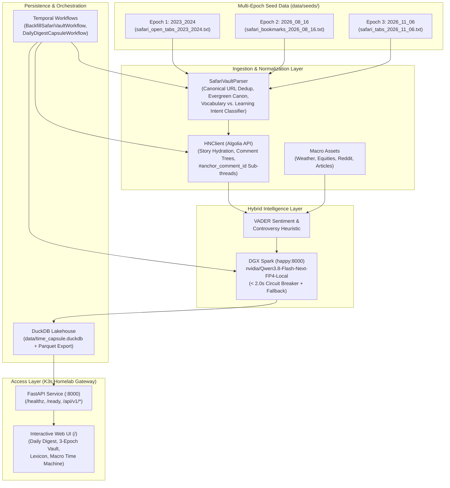

# ADR 0001: Temporal Orchestration, Multi-Epoch Safari Reading Vault & Hybrid DGX Spark Discussion Engine

- **Status**: Accepted
- **Date**: 2026-11-13
- **Deciders**: Principal Systems Architect (`tron-agent-mainframe[bot]`), Paulo Jauregui (`@HowDiggy`)
- **Related ADRs**: `k8s-gitops` ADR-0009 (Temporal Orchestration), ADR-0010 (DuckDB / SeaweedFS Lakehouse)

---

## 1. Context and Problem Statement

In Phase 1, `time-capsule` was prototyped as a standalone Dagster asset pipeline (`weather_assets.py`, `financial_assets.py`) targeting daily macro snapshots (5 world cities via OpenWeatherMap and 5 tech stock tickers via Alpha Vantage). However, three critical architectural limitations emerged:

1. **Lack of Personal Intellectual Signal**: A time capsule that only records external weather and stock prices misses the operator's personal engineering journey, reading habits, vocabulary acquisition, and active technical learning intents.
2. **Orchestration Alignment with `mainframe`**: Across the `paulojauregui` homelab (`mainframe`), workflow orchestration has standardized on **Temporal** (`temporal-frontend.temporal-system.svc.cluster.local:7233`) backed by CloudNativePG, while retaining lightweight standalone execution for local development and CI.
3. **Unstructured Browser Exports Across Years**: Over a multi-year period, the operator exported three major snapshots of Safari open tabs and bookmarks from Apple Notes (`data/seeds/`):
   - **Epoch 1 (`2023_2024`)**: `safari_open_tabs_2023_2024.txt` (229 raw markdown entries / 206 unique canonical links)
   - **Epoch 2 (`2026_08_16`)**: `safari_bookmarks_2026_08_16.txt` (279 raw markdown entries / 218 unique canonical links)
   - **Epoch 3 (`2026_11_06`)**: `safari_tabs_2026_11_06.txt` (320 raw markdown entries)
   These exports contain rich latent metadata: cross-epoch survival (14 Evergreen Canon items present in all 3 epochs), Hacker News links with specific `#anchor_comment_id` fragments (`#50014121`, `#46143525`, `#47473516`, `#49593756`, `#50140985`), untitled `[Hacker News]` tabs requiring API hydration, and 63 Google Search / dictionary lookups reflecting vocabulary building and technical deep dives.

---

## 2. Architecture Overview

---

## 3. Key Architectural Decisions

### Decision 3.1: Dual-Compatible Core Functions with Temporal Primary Orchestration
- **Choice**: Implement core ingestion, hydration, and enrichment logic as pure, strongly-typed Python functions/classes with Design-by-Contract (`Pre-conditions` / `Post-conditions`), wrapped as both **Temporal Activities/Workflows** (`src/time_capsule/workflows.py`) and **Dagster Assets** (`src/time_capsule/__init__.py`).
- **Rationale**: Preserves 100% backward compatibility with Phase 1 Dagster unit tests while enabling production execution on `mainframe`'s Temporal cluster (`TEMPORAL_HOST=temporal-frontend.temporal-system.svc.cluster.local:7233`) and zero-dependency CLI/startup seeding when Temporal is disabled.

### Decision 3.2: Deterministic URL Canonicalization & Cross-Epoch Survival Algebra
- **Choice**: Canonicalize URLs by normalizing scheme/host (`www.`, `m.youtube.com`, `en.m.wikipedia.org`), stripping ephemeral tracking parameters (`utm_*`, `fbclid`, `gclid`, `_gl`, `sca_esv`, `sxsrf`, `ved`, `biw`, `bih`, `fbs`, `mstk`, `sei`, `ei`, `oq`, `gs_lp`), and preserving semantic identity parameters (`id` for Hacker News, `q` for Google Search, `v` for YouTube).
- **Rationale**: Enables exact set-intersection across epochs $E_1, E_2, E_3$. Any item with $|Epochs(u)| = 3$ is deterministically marked `is_evergreen_canon = True` (yielding the 14 Evergreen Canon items), while `total_occurrences` captures repeated tab openings as an `interest_weight`. Fragment identifiers (`#50014121`, `#46143525`, `#47473516`, `#49593756`, `#50140985`) are extracted and stored on the merged `SafariLinkItem.anchor_comment_id` field before stripping the fragment for canonical story deduplication.

### Decision 3.3: Hybrid VADER + Local DGX Spark (`Qwen3.8-Flash-Next-FP4-Local`) Synthesis
- **Choice**: Combine deterministic lexical sentiment analysis (`vaderSentiment`) with an asynchronous OpenAI-compatible client targeting `http://happy.tail749110.ts.net:8000/v1` (`nvidia/Qwen3.8-Flash-Next-FP4-Local`), guarded by a `< 2.0s` TCP/HTTP circuit breaker and a deterministic heuristic synthesizer fallback.
- **Rationale**: Guarantees zero cloud API cost when DGX Spark (`happy`) is online, while ensuring deterministic `< 1s` unit test execution and 100% uptime in isolated CI or offline environments.

### Decision 3.4: Embedded DuckDB Lakehouse with Parquet Export
- **Choice**: Use DuckDB (`src/time_capsule/repository.py`) as the embedded OLAP/relational store for vault items, discussion analyses, vocabulary entries, learning intents, and daily macro capsules, with native `COPY ... TO ... (FORMAT PARQUET)` export for SeaweedFS S3 archival.
- **Rationale**: Eliminates external database container dependencies for fast local development and K3s single-replica deployment while providing sub-millisecond analytical filtering across epochs, pillars, and sentiment scores.

---

## 4. Consequences

### Positive
- All 3 Safari seed epochs (828 raw link lines across `2023_2024`, `2026_08_16`, `2026_11_06`) are automatically parsed, deduplicated, classified into the 6 Intellectual Pillars, and pre-loaded on startup.
- Untitled `[Hacker News]` tabs and `#anchor_comment_id` bookmarks are first-class citizens with dedicated comment-tree hydration.
- Full compliance with `mainframe` deployment standards (`USER 10001:10001`, `/healthz`, `/ready`, Kustomize `homelab-gateway` HTTPRoute, GitHub Actions CI/CD).

### Risks & Mitigations
- **DuckDB Single-Writer Concurrency**: Mitigated by `strategy: Recreate` in `deploy/base/01-deployment.yaml` and thread-safe connection pooling inside `TimeCapsuleRepository`.
- **External API Rate Limits (HN Algolia / OpenWeatherMap / Alpha Vantage)**: Mitigated by bounded batch hydration, configurable timeouts, and graceful mock/offline fallbacks.
